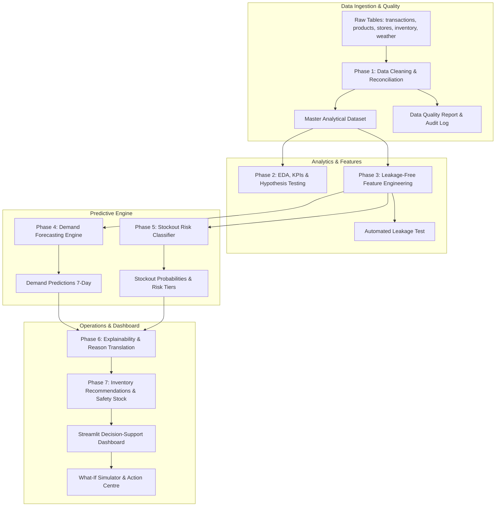

# StockSense Quantix 📈📦

[](https://www.python.org/)
[](https://streamlit.io/)
[](https://scikit-learn.org/)
[](https://xgboost.ai/)
[](https://github.com/sristipokharel9/STOCKSENSE_QUANTIX)

> **Enterprise Decision-Support for NovaMart Retail**  
> Predicts 7-day store-product demand, classifies stock-out risk, translates machine learning signals into plain-language managerial actions, and calculates optimal reorder quantities and safety buffers — all wrapped in an interactive, executive-grade Streamlit dashboard.

---

## 🌟 Executive Overview

Retail chains face a perpetual trade-off between **stock-outs** (lost revenue, disappointed customers, brand erosion) and **over-stocking** (locked working capital, storage overhead, waste and spoilage). Traditional min/max inventory rules fail under shifting demand, price elasticity, and promotional dynamics.

**StockSense Quantix** solves this with an end-to-end, multi-stage machine learning and operational intelligence system:

1. **Automated Data Quality & Cleaning**: Handles missing values, duplicates, category typos, negative quantities, extreme outliers, and sparse transaction histories.
2. **Rigorous Statistical Foundations**: 4 hypothesis tests evaluating promotional lift, store segmentation, and seasonality.
3. **Strict Leakage-Free Feature Engineering**: Lag and rolling window features guaranteed zero-leakage via automated time-split validation (`tests/test_no_leakage.py`).
4. **Dual-Model ML Architecture**:
   - **Model 1 (Regression)**: Predicts next 7-day demand across store-product pairs.
   - **Model 2 (Classification)**: Forecasts 7-day stockout risk (High, Medium, Low) with imbalanced-data handling.
5. **Manager-Centric Explainability (XAI)**: Converts permutation feature importances into plain-English reasoning for store and supply chain managers.
6. **Actionable Operations Engine**: Computes dynamic Safety Stock, Reorder Quantities, estimated Revenue at Risk, and automated managerial prescriptions.
7. **Interactive Streamlit Command Centre**: 7 analytical tabs featuring executive KPIs, demand curves, inventory buffers, and a What-If scenario simulator.

---

## 🏗️ System Architecture



---

## 📊 Key Highlights & Pipeline Stages

### 1. Data Cleaning & Trap Ingestion (`Phase 0 & 1`)
- Reconciles closing inventory arithmetic: $\text{Closing} = \text{Opening} + \text{Received} - \text{Sold}$.
- Standardizes inconsistent product categories and store IDs.
- Capped extreme demand spikes at the 99.9th percentile to prevent scale distortion in distance/gradient models.
- Imputes missing weather variables (`temp_c`, `rain_mm`) using hierarchical city-month medians.
- Full auditability logged into `reports/data_quality_report.md`.

### 2. Hypothesis Testing & Statistical Insights (`Phase 2`)
- **Promotions Impact**: Mann-Whitney U test confirms promotions significantly increase units sold ($p < 0.001$).
- **Store Segmentation**: Kruskal-Wallis test confirms demand variance differs significantly across store formats ($H = 6.874, p = 0.032$).
- **Stockout vs Promo**: Chi-square test indicates promotions alone do not directly elevate stockout risk without inventory misallocation ($p = 1.0$).
- **Weekend Effect**: Mann-Whitney U confirms consistent baseline demand across weekday vs weekend ($p = 0.30$).

### 3. Leakage-Free Feature Engineering (`Phase 3`)
- Constructs time, promotional, lag (7-day, 14-day), rolling statistics, inventory velocity, and price elasticity signals.
- All rolling aggregates enforce a strict `shift(1)` to ensure zero data leakage from future timestamps.
- Validated via automated test suite `tests/test_no_leakage.py`.

### 4. Machine Learning Benchmarks (`Phase 4 & 5`)

#### Demand Forecasting Model Comparison (7-Day Horizon)
| Model | Test MAE | Test RMSE | Test MAPE (%) | Test WAPE (%) | Test $R^2$ |
| :--- | :---: | :---: | :---: | :---: | :---: |
| **Linear Regression** | **113.73** | **144.61** | **12.98%** | **11.90%** | **0.744** |
| **XGBoost Regressor** | 115.56 | 146.56 | 13.20% | 12.09% | 0.737 |
| **Random Forest** | 116.91 | 148.02 | 13.37% | 12.23% | 0.732 |
| **Decision Tree** | 135.05 | 173.49 | 15.25% | 14.13% | 0.632 |
| **KNN** | 155.81 | 198.75 | 18.32% | 16.30% | 0.517 |
| **SVR** | 158.84 | 204.08 | 18.70% | 16.62% | 0.491 |
| *Baseline Rolling Mean (7d)* | 173.85 | 218.29 | 19.78% | 18.18% | 0.426 |

#### Stockout Risk Classification Comparison
| Model | Accuracy | Precision | Recall | F1-Score | ROC-AUC | PR-AUC |
| :--- | :---: | :---: | :---: | :---: | :---: | :---: |
| **Random Forest** | 93.31% | 0.957 | 0.959 | **0.958** | **0.970** | **0.991** |
| **XGBoost Classifier**| 91.77% | **0.963** | 0.932 | 0.947 | **0.972** | **0.992** |
| **SVC** | 93.36% | 0.950 | 0.968 | 0.959 | 0.957 | 0.986 |
| **GaussianNB** | **94.36%** | 0.934 | **1.000** | **0.966** | 0.881 | 0.942 |
| **KNN** | 93.28% | 0.932 | 0.988 | 0.959 | 0.918 | 0.965 |
| **Decision Tree** | 89.89% | 0.965 | 0.906 | 0.934 | 0.945 | 0.976 |

### 5. Explainability & Recommendation Engine (`Phase 6 & 7`)
- Global permutation importance highlights primary demand drivers (historical sales velocity, promotional discounts, store inventory levels).
- Local explainability synthesizes model predictions into human-readable manager actions:
  - *"Urgent reorder required: projected demand exceeds available stock by 42 units before replenishment."*
  - *"Healthy stock: coverage exceeds 14 days; hold replenishment."*
  - *"Overstock risk: current inventory exceeds safety buffer by >150%; consider promotional markdown."*

---

## 🖥️ Streamlit Dashboard Walkthrough

The application provides an executive and managerial control tower structured across 7 dedicated tabs:

1. **Executive Summary**: High-level store metrics (Total Revenue, Units Sold, Stockout Rate, Estimated Lost Sales, Inventory Turnover, Days of Inventory).
2. **Demand Intelligence**: Historical demand curves, moving averages, and 7-day forward forecasts by store and SKU.
3. **Inventory Risk**: Visual inventory gauge, safety stock thresholds, and stockout probability distributions.
4. **Manager Action Centre**: Interactive, filterable decision table categorizing items by risk (High, Medium, Low) with recommended reorder quantities.
5. **Model Performance**: Comprehensive evaluation metrics, residual diagnostics, and confusion matrices.
6. **Explainability**: Global feature importance and localized reason breakdowns.
7. **What-If Simulator**: Live simulation tool allowing managers to adjust promo discounts, lead times, and base prices to observe real-time impacts on demand and stockout risk.

---

## 📁 Repository Structure

```text
STOCKSENSE_QUANTIX/
├── dashboard/
│   ├── app.py                     # Streamlit multi-tab decision-support app
│   └── loader.py                  # High-performance artifact loader
├── data/
│   ├── raw/                       # Raw input CSVs (stores, products, transactions, etc.)
│   └── processed/                 # Cleaned datasets and feature store
├── models/
│   ├── demand_model_meta.json     # Demand forecasting model metadata & metrics
│   ├── stockout_model_meta.json   # Stockout classification model metadata & metrics
│   └── explain_meta.json          # Global and local feature importances
├── notebooks/
│   ├── 01_data_quality_and_cleaning.ipynb
│   ├── 02_eda_and_statistics.ipynb
│   ├── 03_feature_engineering.ipynb
│   ├── 04_demand_forecasting.ipynb
│   ├── 05_stockout_classification.ipynb
│   └── 06_explainability_and_recommendations.ipynb
├── reports/
│   ├── data_quality_report.md     # Detailed data cleaning and audit log
│   ├── statistical_tests.md       # Full hypothesis testing results & p-values
│   ├── model_comparison_forecast.csv
│   └── model_comparison_stockout.csv
├── src/
│   ├── config.py                  # Central project paths & hyperparameters
│   ├── simulate_hackathon_tables.py
│   ├── data_cleaning.py           # Automated data quality & trap resolution
│   ├── build_master.py            # Master table join & alignment
│   ├── eda.py                     # Exploratory analysis & charts
│   ├── stats_tests.py             # Hypothesis testing suite
│   ├── features.py                # Feature engineering (strictly lag-shifted)
│   ├── train_forecast.py          # Regression models training & benchmarking
│   ├── train_stockout.py          # Classification models training & benchmarking
│   ├── explain.py                 # Permutation importance & manager explanations
│   ├── recommend.py               # Reorder quantity, safety stock & actions
│   └── run_pipeline.py            # Master orchestration script
├── tests/
│   └── test_no_leakage.py         # Automated data leakage verification suite
├── requirements.txt               # Project dependencies
└── README.md                      # Project documentation
```

---

## ⚡ Quick Start & Setup

### 1. Clone the Repository
```bash
git clone https://github.com/sristipokharel9/STOCKSENSE_QUANTIX.git
cd STOCKSENSE_QUANTIX
```

### 2. Create and Activate Virtual Environment
```bash
# Windows (PowerShell)
python -m venv .venv
.\.venv\Scripts\Activate.ps1

# Linux / macOS
python3 -m venv .venv
source .venv/bin/activate
```

### 3. Install Dependencies
```bash
python -m pip install --upgrade pip
pip install -r requirements.txt
```

### 4. Run the Full End-to-End Pipeline
Execute all phases (data ingestion, cleaning, feature engineering, model training, and recommendations) with one command:
```bash
python src/run_pipeline.py
```

### 5. Launch the Streamlit Dashboard
```bash
streamlit run dashboard/app.py
```
Open your browser at `http://localhost:8501` to interact with the dashboard.

### 6. Run Leakage Tests
Verify that all time-series features respect chronological ordering with zero lookahead bias:
```bash
python tests/test_no_leakage.py
```

---

## 🛠️ Technology Stack

- **Core Analytics & Data Processing**: Python 3.10+, Pandas, NumPy, SciPy, Statsmodels
- **Machine Learning**: Scikit-Learn, XGBoost, Imbalanced-Learn
- **Visualization & Dashboard**: Streamlit, Plotly Express & Graph Objects, Matplotlib, Seaborn
- **Serialization & Environment**: Joblib, OpenPyXL, Jupyter

---

## 👥 Authors & Acknowledgments

- **Sristi Pokharel** ([@sristipokharel9](https://github.com/sristipokharel9))
- Developed for **NovaMart Retail** / **IntelliData 2026 Data Science Hackathon**
- Dataset Reference: Kaggle *Retail Store Inventory Forecasting Dataset* by Anirudh Chauhan.